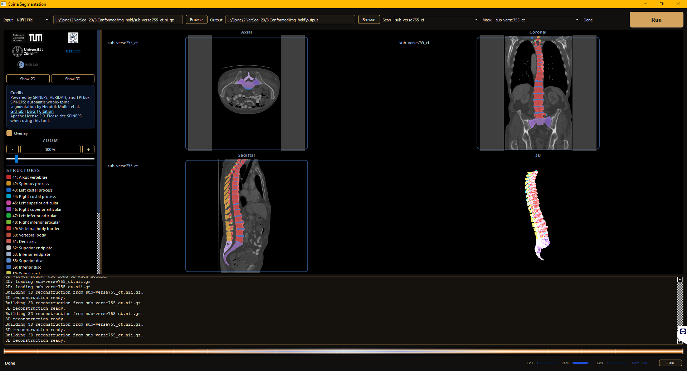

# Graphical User Interface for the SPINEPS models
## Download

## Download the packaged Windows `.zip` from ownCloud: <https://owncloud.damutten.ch/s/hWm6MsNE1yTVPkv>

Keep the extracted folder together. The executable depends on bundled files in `_internal`.

## About

Desktop GUI for whole-spine segmentation with [SPINEPS](https://SPINEPS.readthedocs.io/).

This project packages the SPINEPS workflow into a hospital-friendly desktop application: select DICOM or NIfTI input, run segmentation locally, watch progress and system resources, then inspect the scan with an overlay and optional 3D surface view.



## What It Does

SPINEPS performs whole-spine segmentation through a two-phase pipeline:

- semantic segmentation of spinal structures and vertebra subregions
- instance segmentation of individual vertebrae
- optional VERIDAH vertebra labeling
- centroid and snapshot generation

The GUI wraps that workflow for Windows workstations and research machines. It handles input preparation, DICOM conversion, model loading, cached result detection, segmentation, overlay viewing, and export-oriented output folders.

## Features

- DICOM folder input with automatic DICOM-to-NIfTI conversion
- NIfTI input support (`.nii`, `.nii.gz`)
- robust DICOM series discovery that skips localizers, topograms, protocol images, and non-volume series
- local SPINEPS inference using CT models by default
- optional CPU mode through environment variable
- progress log with stage-aware status updates
- CPU, RAM, GPU, and process memory monitor strip
- axial, coronal, and sagittal viewer with segmentation overlay
- 3D surface visualization and STL-oriented workflow support
- cached output reuse for repeated review


## Run from source on Linux

The source GUI, pipeline, and platform helpers are included in this repository. Use a separate `spine` environment because SPINEPS 2.1.2 requires a different nnU-Net version from the older toolkit models.

```bash
conda env create -f environment.yml
conda activate spine
python -m pip install torch==2.7.1 torchvision==0.22.1 torchaudio==2.7.1 --index-url https://download.pytorch.org/whl/cu128
python -m pip install -c constraints.txt -r requirements.txt
python -m pip check
bash run_linux.sh
```

CUDA 12.8 wheels were tested on Blackwell. For a CPU-only machine, install the matching CPU PyTorch wheels and set `SPINEPS_GUI_CPU=1`. Model weights download through SPINEPS on first use; they are not included in this repository.

For a conda installation outside `~/miniconda3`, set `SPINE_PYTHON=/absolute/path/to/spine/bin/python` when launching. The launcher adds the environment's `bin` folder to `PATH`, including its native `dcm2niix`.

On Windows, the source GUI expects the environment name `gui`; create it with `conda env create -n gui -f environment.yml`, install the dependencies in that environment, then run `python gui.py`. The packaged Windows download above remains available. The source changes in this pull request were tested on Linux; no fresh Windows validation was performed.

See [VALIDATION.md](VALIDATION.md) for startup and real-input integration checks. Generated scans, segmentation masks, derivatives, and model weights are excluded by `.gitignore`.

## Basic Workflow

1. Choose `DICOM Folder` or `NIfTI File`.
2. Select the source scan.
3. Choose an output directory.
4. Start the pipeline.
5. Review the segmentation overlay when processing finishes.

The pipeline writes intermediate and final files into the selected output directory. Reusing the same output directory lets the GUI reuse cached conversions or segmentations when possible.

## Outputs

Typical output folders include:

```text
output/
  nifti_tmp/          converted or copied scan volumes
  segmentation/       GUI-ready segmentation overlays
  derivatives_seg/    native SPINEPS derivatives
```

SPINEPS derivatives may include:

- `seg-spine` semantic/subregion mask
- `seg-vert` vertebra instance mask
- centroid JSON
- snapshot PNG
- raw/model-space outputs depending on SPINEPS configuration


## Notes And Limitations

- This is a research/engineering GUI and is not a standalone clinical decision system.
- Input quality, field of view, modality, orientation, metal artifacts, and scan protocol can affect segmentation quality.
- DICOM conversion selects plausible volume series and skips localizers/reformats; always verify the selected output visually.
- GPU inference depends on the installed PyTorch/CUDA runtime in the source environment or the bundled runtime in the packaged app.
- Medical images, generated outputs, model weights, and large vendor/runtime bundles should not be committed to git.


## License

This GUI is distributed for academic non-commercial use. See [LICENSE.txt](LICENSE.txt).

SPINEPS is released under the Apache License 2.0. Copyright 2023 Hendrik Möller. See the [upstream SPINEPS repository](https://github.com/Hendrik-code/spineps).

## Citation

If you use this GUI or the thoracolumbar CT subregion workflow, please cite:

```bibtex
@article{damutten_thoracolumbar_2026,
  title   = {Fully Automated Segmentation of Anatomical Subregions of the Thoracolumbar Spine on Computed Tomography},
  doi     = {10.1007/s10278-026-02169-7},
  journal = {Journal of Imaging Informatics in Medicine},
  author  = {Da Mutten, Raffaele and Theiler, Sven and Bottini, Massimo and de Wilde, Daniel and Zanier, Olivier and Maldaner, Nicolai and Voglis, Stefanos and El-Hajj, Victor Gabriel and Elmi-Terander, Adrian and van Doormaal, Tristan P. C. and Germans, Menno R. and Bellut, David and Regli, Luca and Serra, Carlo and Staartjes, Victor E.},
  date    = {2026-08-10}
}
```

If you use the SPINEPS backend, cite the upstream SPINEPS work:

```bibtex
@article{moller_SPINEPSautomatic_2024,
  title   = {{SPINEPS}--automatic whole spine segmentation of T2-weighted {MR} images using a two-phase approach to multi-class semantic and instance segmentation},
  doi     = {10.1007/s00330-024-11155-y},
  journal = {European Radiology},
  author  = {Moller, Hendrik and Graf, Robert and Schmitt, Joachim and Keinert, Benjamin and Schon, Hanna and Atad, Matan and Sekuboyina, Anjany and Streckenbach, Felix and Kofler, Florian and Kroencke, Thomas and Bette, Stefanie and Willich, Stefan N. and Keil, Thomas and Niendorf, Thoralf and Pischon, Tobias and Endemann, Beate and Menze, Bjoern and Rueckert, Daniel and Kirschke, Jan S.},
  date    = {2024-10-29}
}
```

